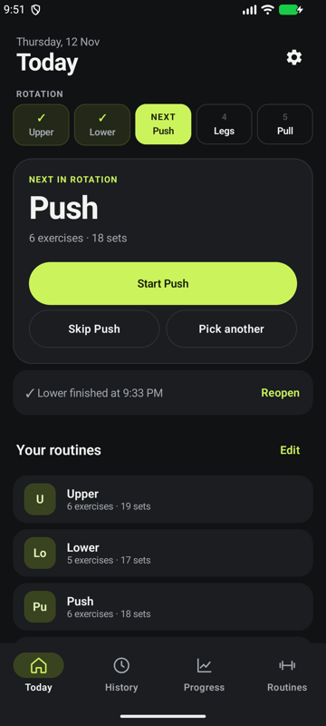
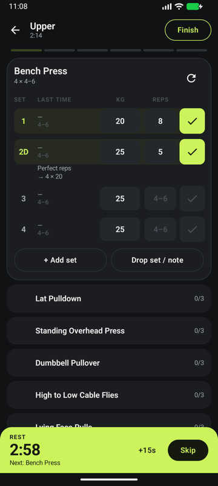
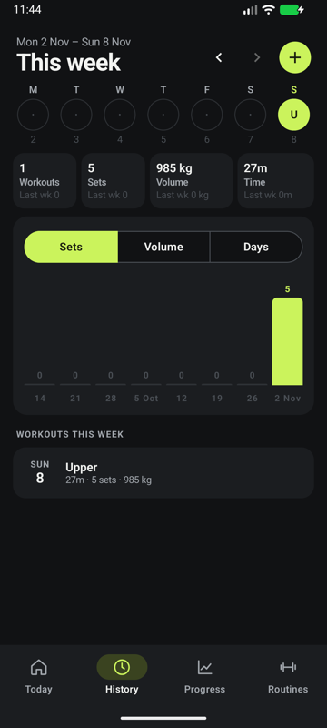
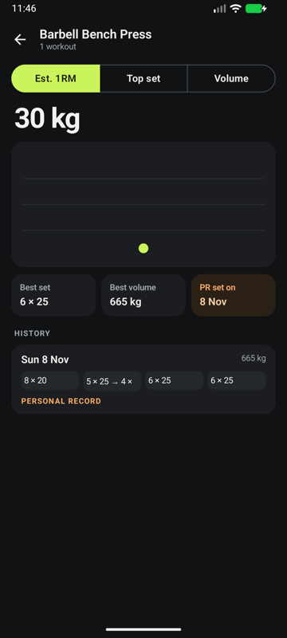
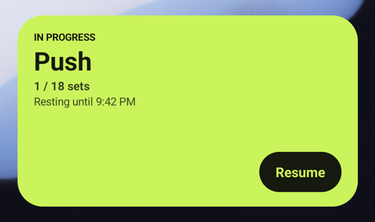

# PumpLog

[](https://github.com/snehgada/PumpLog/releases/latest)

A personal, offline Android app for logging gym workouts on a fixed split — built to replace a Google Sheet.

You set up your routines once (Upper, Lower, Push, Pull, Legs…). PumpLog keeps track of which one is next, shows what
you lifted last time on every set, suggests when to add weight, times your rest, and charts your progress.

<p>
  
  
  
  
</p>

## Features

- **Rotation, not a calendar.** Routines run in a fixed order. Miss a gym day and the next workout simply waits; skip
  one and the rotation moves on (with Undo). Start a different routine any day with *Pick another*.
- **Logging built for the gym floor.** Each set shows what you did last time, with the weight pre-filled. Tick to log,
  untick to undo, add extra sets.
- **Drop sets, warm-ups, failure sets and notes** per set; **reverse-pyramid (RPT)** rep ranges per set; **swap an
  exercise for the day** while its history stays with the planned exercise.
- **Progression hint.** Hit the top of every rep range and PumpLog suggests the next weight (step size configurable,
  separately for barbell/cable/machine and dumbbells).
- **Rest timer** with a lock-screen countdown and a vibrating "Rest's up" alert, delivered through Android's alarm
  system so it still fires on phones that freeze apps in the background.
- **History:** workout days and skips per week, weekly sets / volume / time against last week, an 8-week chart, and
  editing or back-filling past workouts.
- **Progress:** per-exercise charts of estimated 1RM, top set and volume, with best set and personal records.
- **Routine editor:** reorder the rotation, edit sets and rep ranges, rest times, alternatives; rename an exercise
  everywhere at once.
- **Home-screen widget:** the next routine with *Start*, or the workout in progress with sets logged, rest end time
  and *Resume*.

  

- **kg or lb**, dark theme throughout.

## Privacy

PumpLog has **no internet permission**: it cannot send anything anywhere. There are no accounts, ads or analytics.
Your workouts are stored only on the phone (SQLite via Room) and are included in Android's own backup if you have it
switched on.

## Requirements

- An Android phone running **Android 12 or newer**.
- To build: **JDK 17** and the **Android SDK** (platform 35). Android Studio works for editing; for command-line builds
  use a JDK 17 such as Homebrew's `openjdk@17` — the Java bundled with recent Android Studio releases is too new for
  the Gradle version used here.

## Download

Get the APK from the [latest release](https://github.com/snehgada/PumpLog/releases/latest), open it on an Android 12+
phone, and allow installing when Android asks. Or build it yourself:

## Build and install

```bash
git clone https://github.com/snehgada/PumpLog.git
cd PumpLog
echo "sdk.dir=$HOME/Library/Android/sdk" > local.properties   # path to your Android SDK
export JAVA_HOME="$(brew --prefix openjdk@17)/libexec/openjdk.jdk/Contents/Home"

./gradlew testDebugUnitTest      # unit tests
./gradlew assembleRelease        # app/build/outputs/apk/release/app-release.apk
```

Install on a phone connected over USB (with USB debugging on):

```bash
adb install -r app/build/outputs/apk/release/app-release.apk
```

Some phones (OnePlus/Oppo among them) also need **Developer options → Install via USB** enabled and ask you to confirm
each install on the phone.

### About signing

The release build is signed with the **Android debug key of the machine that builds it**
(`~/.android/debug.keystore`). Android only lets an app update itself in place when the new version is signed with the
same key, so:

- Building on the same machine every time keeps updates working and your data intact.
- Building on a different machine produces a different key; installing it means uninstalling first, which deletes the
  workouts on the phone. Back up that keystore file if you rely on the app.

The app ID is `com.workouttracker` (the project's original name); it is kept so existing installs keep updating.

### On OnePlus and similar phones

PumpLog's rest alert works without changes, but if one ever arrives late, open **Settings** (gear icon on Today) →
**Open settings** next to *Background activity* → **Battery → Allow background activity**. Settings also has a
**Test rest alert** button.

## Tech stack

Kotlin 2.1 · Jetpack Compose with Material 3 · Room 2.6 (schema exported to `app/schemas/`, with migrations) ·
DataStore · Navigation Compose · Jetpack Glance (widget) · AlarmManager + a foreground service for the rest timer ·
JUnit 4. Single Gradle module, no dependency-injection framework, minSdk 31 / targetSdk 35.

## Project layout

```
app/src/main/java/com/workouttracker/
├── domain/      Pure Kotlin rules: rotation, progression, 1RM, weekly totals, input validation (unit-tested)
├── data/        Room database, DAOs, repositories, DataStore settings, the seeded starter routines
├── timer/       Rest timer: alarm-based alert, countdown service, notifications
├── widget/      Home-screen widget (Glance)
└── ui/          Compose screens: today, workout, history, progress, routines, settings, welcome, theme
app/src/test/    Unit tests for the domain rules and seed data
PLAN.md          Design decisions, data model and milestone notes
```

The app ships with the author's own five-day split pre-loaded on first launch (`data/seed/SeedRoutines.kt`); every
routine can be edited, reordered, deleted or replaced in the app.

## License

[MIT](LICENSE) © 2026 Sneh Gada
